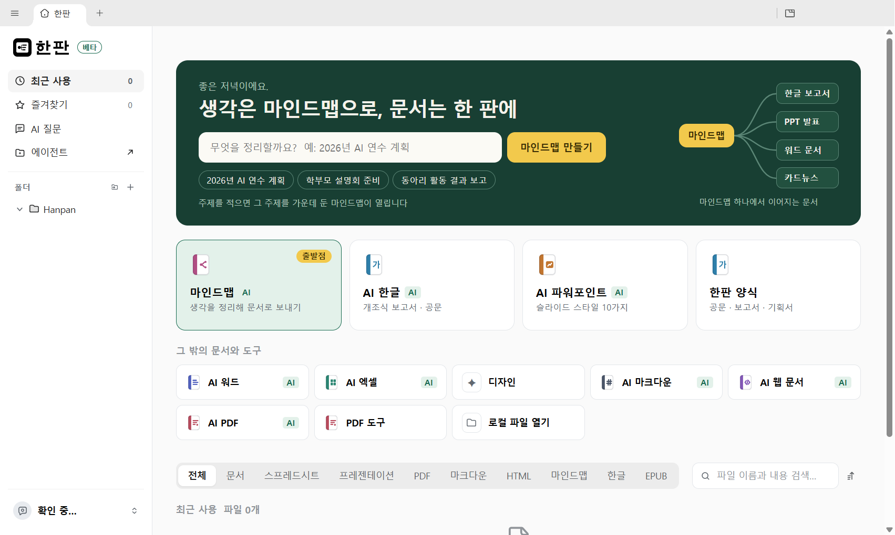
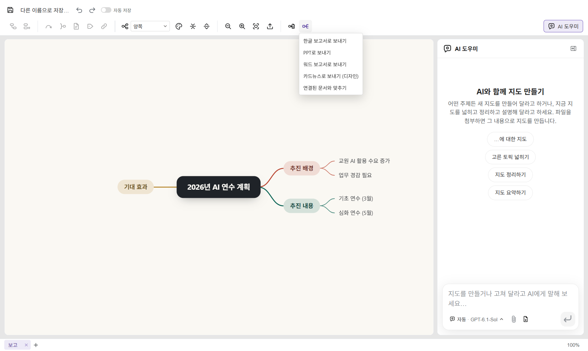
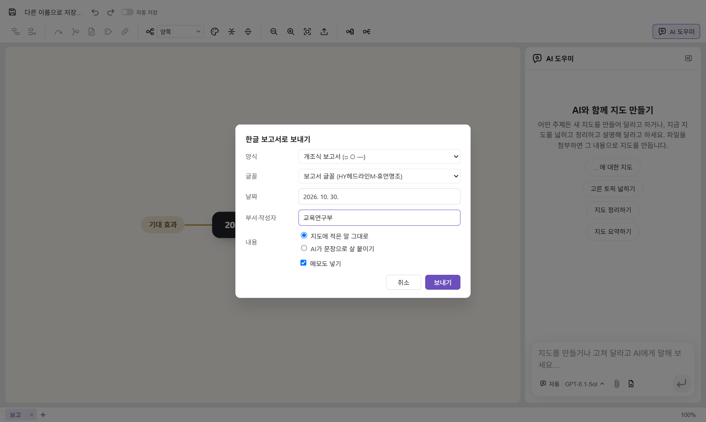
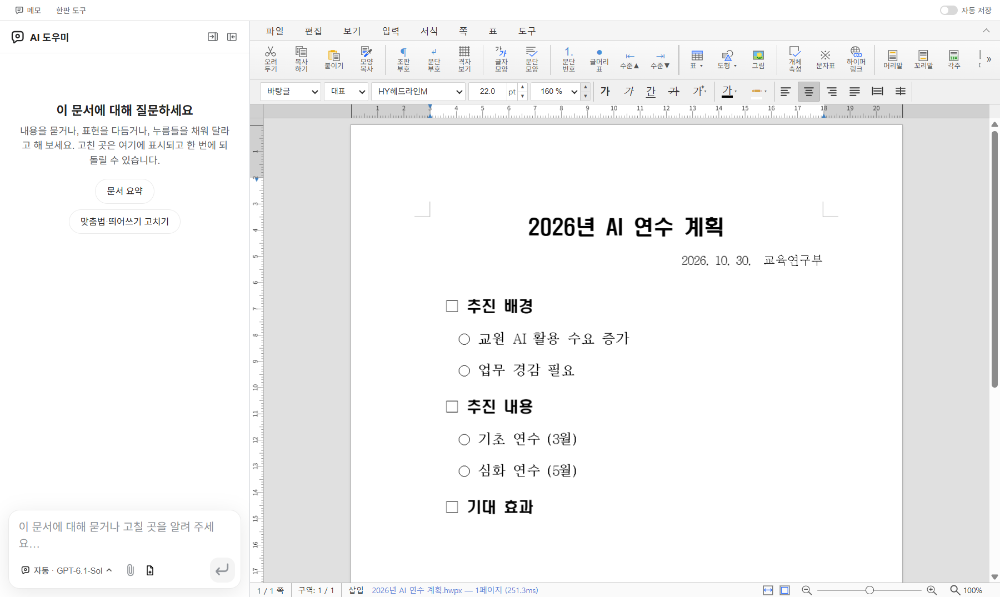
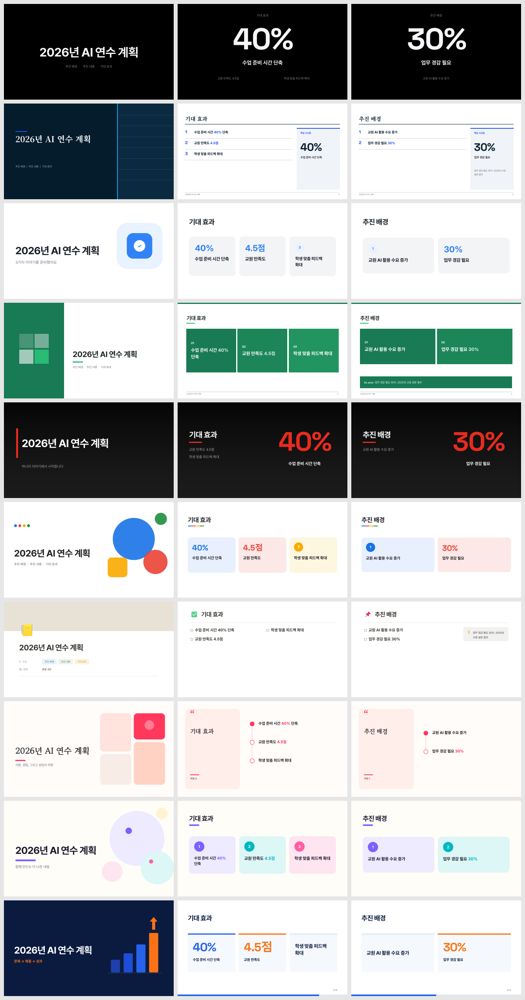
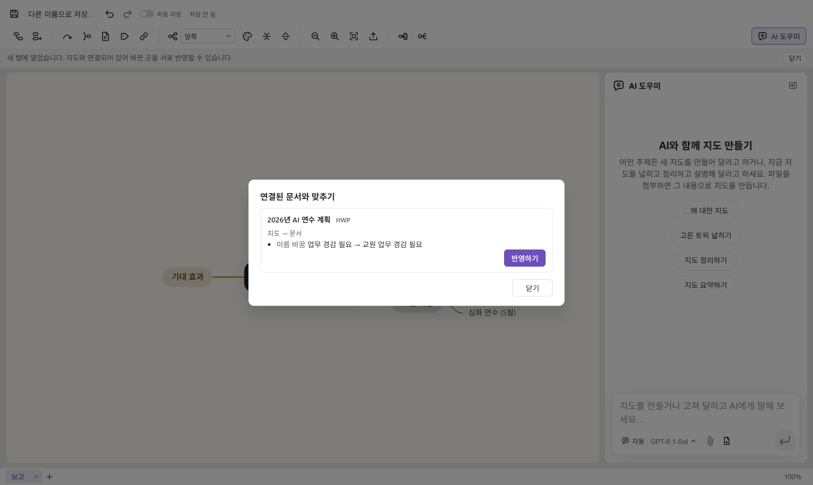
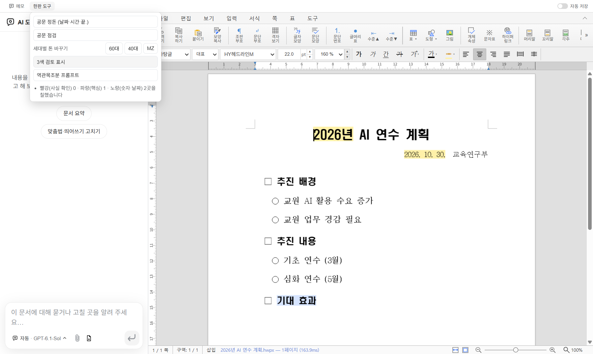
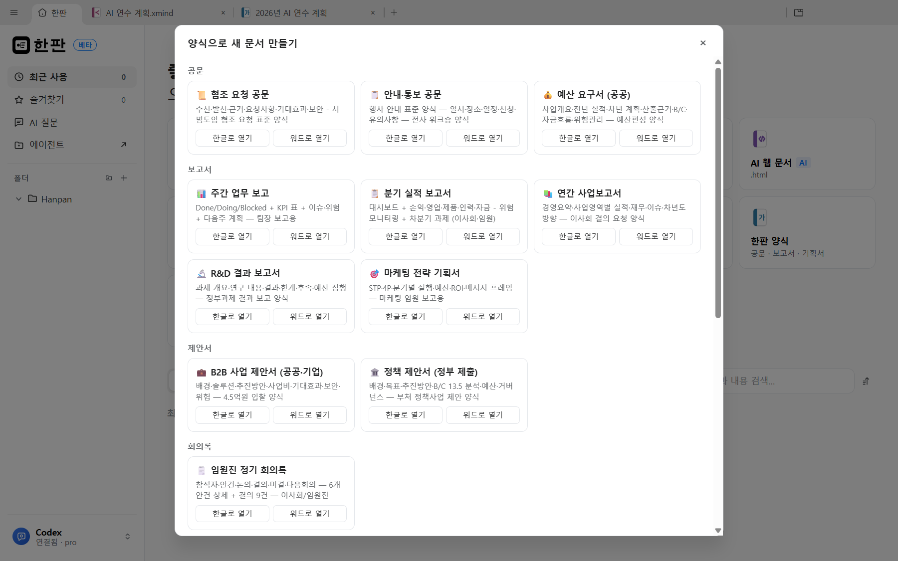
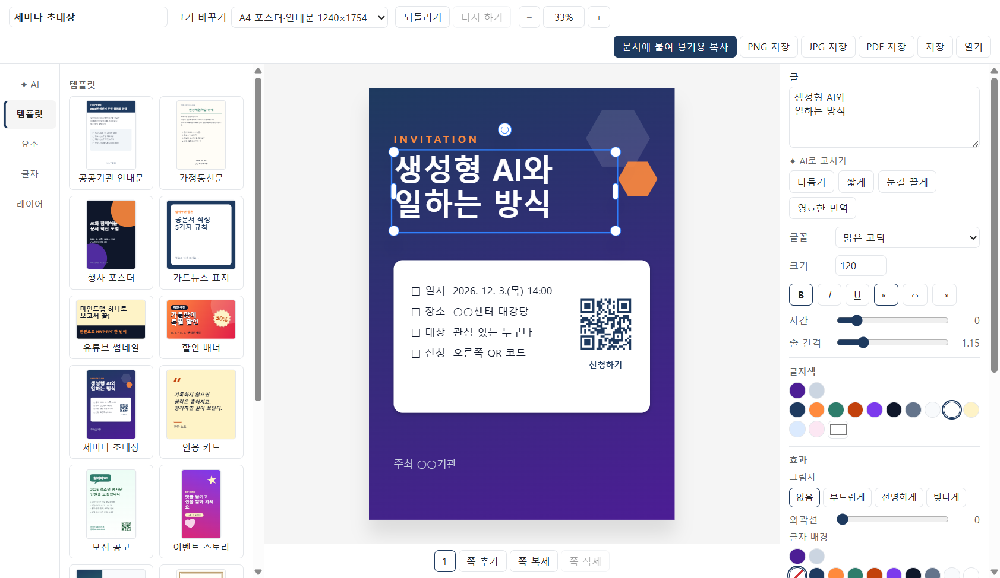

# 한판 사용설명서

> 하나의 판에서 생각하고, 쓰고, 발표하고, 꾸민다.

한판은 마인드맵으로 정리한 생각을 **한글(HWP) 보고서·PPT·워드**로 보내 같은 창에서 이어 쓰고, 마인드맵과 문서를 서로 맞추는 데스크톱 오피스입니다. 공공기관·학교에서 쓰는 공문과 보고서 양식이 들어 있고, AI는 **내 PC에 깔린 AI**를 먼저 씁니다.

앱 안에서도 같은 안내를 볼 수 있습니다. 메뉴의 **도움말 › 사용 설명서**(F1)를 누르고 맨 위의 **한판 시작하기**를 고르세요.

## 차례

1. [홈 화면](#1-홈-화면)
2. [마인드맵을 한글·PPT·워드로 보내기](#2-마인드맵을-한글pptx워드로-보내기)
3. [마인드맵과 문서 맞추기](#3-마인드맵과-문서-맞추기)
4. [한판 도구 (한글 탭)](#4-한판-도구-한글-탭)
5. [한판 양식](#5-한판-양식)
6. [디자인 (포스터·카드뉴스·안내문)](#6-디자인-포스터카드뉴스안내문)
7. [내 PC AI](#7-내-pc-ai)
8. [자주 묻는 것](#8-자주-묻는-것)
9. [알려진 한계](#9-알려진-한계)

---

## 1. 홈 화면

앱을 열면 홈 화면이 나옵니다. 한판의 일은 마인드맵에서 시작하므로, 홈도 마인드맵을 중심으로 놓여 있습니다.

- **시작판(초록 판)**: 정리할 주제를 적고 **마인드맵 만들기**를 누르면, 그 주제를 가운데 둔 새 마인드맵이 열립니다. 아래의 예시 주제를 눌러도 됩니다. 오른쪽 작은 그림은 그 마인드맵이 한글 보고서·PPT·워드·카드뉴스로 이어진다는 뜻입니다.
- **큰 카드 네 장**: 일이 흘러가는 순서대로 **마인드맵**(출발점) → **AI 한글** → **AI 파워포인트** → **한판 양식**입니다.
- **그 밖의 문서와 도구**: AI 워드, AI 엑셀, 디자인, AI 마크다운, AI 웹 문서, AI PDF, PDF 도구, 로컬 파일 열기.
- 아래 목록에서 최근에 쓴 파일을 엽니다.

| 카드 | 하는 일 |
| --- | --- |
| **마인드맵** | 새 마인드맵(.xmind). 생각을 정리해 문서로 보내는 출발점 ([2장](#2-마인드맵을-한글pptx워드로-보내기)) |
| AI 한글 | 새 한글 문서(.hwp/.hwpx). 개조식 보고서·공문 |
| AI 파워포인트 | 새 PPT 문서. 슬라이드 스타일 10가지 |
| **한판 양식** | 공문·보고서·기획서 양식 19가지 ([5장](#5-한판-양식)) |
| AI 워드 · AI 엑셀 | 새 워드·엑셀 문서 |
| **디자인** | 포스터·카드뉴스·안내문 ([6장](#6-디자인-포스터카드뉴스안내문)) |
| PDF 도구 | PDF 병합·분할·정리 |

화면 언어는 기본이 한국어입니다. 다른 언어로 바꾸려면 **설정 › 언어**에서 고릅니다.

## 2. 마인드맵을 한글·PPT·워드로 보내기

생각을 마인드맵으로 먼저 정리하고, 버튼 하나로 문서를 만드는 것이 한판의 중심 기능입니다.

### 2-1. 보내기 메뉴

마인드맵 도구 줄 오른쪽의 **보내기** 단추(판 모양 아이콘)를 누르면 다음이 나옵니다.

- **한글 보고서로 보내기**: 개조식 보고서(.hwpx)
- **PPT로 보내기**: 슬라이드(.pptx)
- **워드 보고서로 보내기**: 보고서(.docx)
- **카드뉴스로 보내기 (디자인)**: 디자인 보드의 카드뉴스 ([6장](#6-디자인-포스터카드뉴스안내문))
- **연결된 문서와 맞추기**: 이미 보낸 문서와 마인드맵 맞추기 ([3장](#3-마인드맵과-문서-맞추기))

### 2-2. 보내기 창

| 항목 | 설명 |
| --- | --- |
| 양식 | **개조식 보고서**(□ ○ ― ·), **장 나눈 보고서**(Ⅰ. Ⅱ. 아래 □ ○), **공문 번호**(1. 가. 1) 가) (1) (가)) |
| 글꼴 | **보고서 글꼴**(HY헤드라인M·휴먼명조·한양중고딕) 또는 **기본 글꼴**(함초롬) |
| 날짜 | 오늘 날짜가 공문 표기(2026. 10. 30.)로 들어갑니다 |
| 부서·작성자 | 제목 아래 날짜 옆에 들어갑니다 |
| 내용 | **마인드맵에 적은 말 그대로**, 또는 **AI가 문장으로 살 붙이기**(각 항목을 "~함", "~임"으로 끝나는 개조식 문장으로 늘려 씀) |
| 메모도 넣기 | 토픽 메모를 항목 아래 설명으로 넣습니다. "※"로 시작하는 메모는 참고 문구가 됩니다 |

**보내기**를 누르면 같은 창의 새 탭에 문서가 열립니다. 아직 저장되지 않은 새 문서이므로, 처음 저장할 때 저장할 곳을 묻습니다.

### 2-3. 마인드맵이 문서가 되는 방식

| 마인드맵 | 한글·워드 보고서 | PPT |
| --- | --- | --- |
| 중심 주제 | 보고서 제목 + 날짜·부서 줄 | 표지 슬라이드 |
| 큰 가지 | □ 항목 (장 보고서면 Ⅰ. 장 제목) | 슬라이드 한 장의 제목 |
| 그 아래 가지 | ○ → ― → · | 글머리 항목(들여쓰기) |
| 메모 | 항목 아래 설명, ※ 참고 | 발표자 메모 |
| 그림 | 항목 아래 그림 | — |

한 슬라이드에 항목이 9개를 넘으면 "(계속)" 슬라이드로 나뉩니다.

### 2-4. PPT 슬라이드 스타일

**PPT로 보내기** 창의 **슬라이드 스타일**에서 10가지 디자인 중 하나를 고르면, 표지와 본문 슬라이드가 그 스타일로 꾸며져 나옵니다. 처음 값은 맥킨지 스타일이고, **기본 (꾸밈 없음)**을 고르면 예전처럼 흰 바탕 글머리 슬라이드가 됩니다.

| 스타일 | 이런 발표에 | 슬라이드 모습 |
| --- | --- | --- |
| 스티브 잡스 | 비전·핵심 제안 | 검은 바탕, 큰 한 문장, 넓은 여백 |
| 맥킨지 | 시장분석·문제정의·실행계획 | 결론 제목, 파란 띠, "핵심 시사점" 상자 |
| 토스 | 서비스·고객 관점 소개 | 쉬운 말, 둥근 카드 |
| BCG | 사업모델·경쟁전략·포지셔닝 | 초록 2×2 매트릭스 |
| TED | 자기 브랜딩·영감형 발표 | 어두운 바탕, 빨간 강조선, 이야기 흐름 |
| 구글 머티리얼 | 학습 자료·프로세스 설명 | 색 동그라미, 또렷한 정보 구조 |
| 노션 | 강의 노트·워크숍·로드맵 | 블록형 체크리스트, 절제된 미니멀 |
| 에어비앤비 | 브랜드 스토리·고객 여정 | 따뜻한 살구색, 명조 글꼴 |
| 캔바 모던 | 팀 과제·행사 안내·홍보 | 그라데이션 표지, 번호 동그라미 |
| 스타트업 피치덱 | 제안서·사업계획·데모데이 | 문제→해결→성과 화살표, 숫자 강조 |

스타일을 고르면 표지, 목차(큰 가지가 셋 이상일 때, 잡스·TED 스타일은 빼고), 큰 가지마다 한 장, 마무리 슬라이드로 덱이 만들어집니다. 각 장의 모양은 가지에 든 내용을 따라 바뀝니다. 하위 가지가 있으면 카드·표·매트릭스로, 내용이 한 줄이면 큰 문장으로, 비어 있으면 장 구분 슬라이드로, 항목이 많으면 번호 목록으로 놓입니다.

단위가 붙은 숫자(30%, 2배, 120명, 4.5점 등)는 강조됩니다. 잡스·TED·맥킨지 스타일은 가지 이름에 든 숫자를 아주 크게, 토스·머티리얼·피치덱 스타일은 카드 위에 크게 보여 줍니다. 날짜(3월, 2026년)는 숫자로 치지 않습니다.

글꼴은 한판에 들어 있는 프리텐다드·본명조·고운바탕을 씁니다. 만든 슬라이드는 PPT 탭에서 글자·색·도형을 그대로 고칠 수 있습니다. 파워포인트로 열 때 이 글꼴이 PC에 없으면 비슷한 글꼴로 바뀌어 보이니, 설치 폴더의 `resources	emplate-fonts`에서 글꼴 파일을 두 번 눌러 설치하면 같은 모양으로 보입니다.

## 3. 마인드맵과 문서 맞추기

보낸 뒤에도 마인드맵과 한글 문서는 연결되어 있습니다. 어느 쪽을 고쳐도 다른 쪽에 반영할 수 있습니다.

1. 마인드맵에서 **보내기 › 연결된 문서와 맞추기**를 누릅니다.
2. 연결된 문서마다 바뀐 곳이 나옵니다.
   - **마인드맵 → 문서**: 마인드맵에서 추가·이름 바꿈·옮김·삭제한 것
   - **문서 → 마인드맵**: 한글 문서에서 □ ○ ― 같은 항목을 새로 쓰거나 고친 것
   - **양쪽에서 다르게 고친 곳**: 마인드맵 쪽 / 문서 쪽 / 나중에 가운데 고릅니다
3. **반영하기**를 누릅니다.
   - 마인드맵 쪽 변경은 되돌리기(Ctrl+Z) 한 번으로 취소할 수 있습니다.
   - 문서가 탭에 열려 있으면 탭에 바로 반영되고 "저장 안 됨"으로 표시됩니다. 저장하지 않으면 원래대로 남습니다.
   - 문서가 닫혀 있으면 파일에 저장하고, 이전 파일은 `.bak`으로 남깁니다.

**지켜지는 것**: 문서에서 직접 쓴 본문 문장은 마인드맵 때문에 덮어써지지 않습니다. 맞추기는 항목(뼈대)만 주고받습니다.

**연결이 유지되는 원리**: 보낼 때 문서의 각 항목에 마인드맵 토픽을 가리키는 보이지 않는 책갈피를 넣습니다. 한글에서 .hwp나 .hwpx로 저장해도 남습니다. 연결 기록은 PC의 앱 데이터 폴더(`hanpan-links.json`)에만 있고 문서 파일에는 책갈피 외에 아무것도 남지 않습니다.

## 4. 한판 도구 (한글 탭)

한글 탭 위쪽 띠의 **한판 도구**를 누르면 글집에서 가져온 도구가 나옵니다. AI 없이 이 PC 안에서 처리합니다.

| 도구 | 하는 일 |
| --- | --- |
| 공문 정돈 | 날짜를 `2026. 5. 8.`, 시각을 `14:30`(24시각제)으로 바꾸고, 본문 끝에 "  끝."을 붙입니다 |
| 공문 점검 | 수신·제목 줄, 끝 표시, 날짜·시각 표기, 항목 번호 차례(1. 가. 1) 가)), "~합니다/~한다" 섞임을 알려 줍니다 |
| 세대별 톤 바꾸기 | 60대(정중한 경어체) · 40대(간결) · MZ(짧고 발랄, 이모지) 말투로 어미를 바꿉니다 |
| 3색 검토 표시 | **빨강** 사실 확인이 필요한 말(추정, 약, 전망…) · **파랑** 핵심(핵심, 반드시, 목표…) · **노랑** 숫자·날짜·금액에 형광펜을 칠합니다 |
| 역관목조분 프롬프트 | 역할·관련분야·목적·조건·분량과 유형(요약·정리·분석·생성·설명)을 채워 프롬프트를 만들고 복사합니다. AI 창에 붙여 넣어 쓰세요 |

문서를 고치는 도구는 결과를 탭에 바로 보여 줍니다. 마음에 들지 않으면 저장하지 않고 닫으면 됩니다.

## 5. 한판 양식

홈 화면의 **한판 양식** 카드를 누르면 양식 19가지가 종류별로 나옵니다. 각 양식에서 **한글로 열기** 또는 **워드로 열기**를 누르면 새 탭에 열립니다.

| 종류 | 양식 |
| --- | --- |
| 공문 | 협조 요청 공문, 안내·통보 공문, 예산 요구서 (공공) |
| 보고서 | 주간 업무 보고, 분기 실적 보고서, 연간 사업보고서, R&D 결과 보고서, 마케팅 전략 기획서 |
| 제안서 | B2B 사업 제안서 (공공·기업), 정책 제안서 (정부 제출) |
| 회의록·메모 | 임원진 정기 회의록, 내부 메모 (팀 스프린트) |
| 사업기획 | 3개년 사업계획서, IR 피치 (투자유치), 시장 분석 보고서, 사업타당성 분석 |
| 콘텐츠 | 조합원 뉴스레터, 홍보 영상 기획서 (1분 숏폼), 보도자료 (언론 배포용) |

양식 안의 ○○○ 자리를 실제 내용으로 바꿔 쓰세요. 공문 양식에는 [한판 도구](#4-한판-도구-한글-탭)의 **공문 정돈**과 **공문 점검**을 함께 쓰면 좋습니다.

## 6. 디자인 (포스터·카드뉴스·안내문)

홈 화면의 **디자인** 카드를 누르면 디자인 창이 열립니다.

- **왼쪽**: 템플릿(공공기관 안내문, 가정통신문, 행사 포스터, 카드뉴스 표지, 유튜브 썸네일), 빈 판형(카드뉴스 1:1, A4, 썸네일, 16:9, 세로 스토리), 요소 넣기(제목, 본문, 사각형, 원, 선, 그림)
- **가운데**: 요소를 끌어 옮기고, 오른쪽 아래 동그라미를 끌어 크기를 바꿉니다
- **오른쪽**: 고른 요소의 글, 글꼴, 크기, 정렬, 굵게, 색, 채우기, 선, 모서리, 투명도, 앞으로/뒤로, 복제, 삭제
- **아래**: 쪽 고르기, 쪽 추가·복제·삭제

| 단추 | 하는 일 |
| --- | --- |
| 문서에 붙여 넣기용 복사 | 지금 쪽을 그림으로 복사합니다. 한글·워드·PPT 탭에서 Ctrl+V |
| PNG 저장 | 지금 쪽을 그림 파일로 |
| PDF 저장 | 모든 쪽을 PDF 한 파일로 |
| 저장 / 열기 | 디자인 파일(.hpdesign, 그림 포함) |

단축키: Delete(지우기), Ctrl+D(복제), 방향키(1칸 이동, Shift는 10칸), Ctrl+Z / Ctrl+Y(되돌리기/다시 하기)

**마인드맵 → 카드뉴스**: 마인드맵에서 **보내기 › 카드뉴스로 보내기**를 누르면 표지 한 장과 큰 가지마다 카드 한 장이 만들어집니다. 디자인 창의 **개요로 카드뉴스**에 들여쓴 글을 붙여 넣어도 됩니다.

## 7. 내 PC AI

한판은 문서를 PC 밖으로 보내지 않고 쓸 수 있도록 **이 PC에 깔린 AI를 먼저** 씁니다.

- 처음 시작할 때 이 PC의 AI 서버를 찾습니다: Ollama(11434), LM Studio(1234), vLLM(8000·8001, TenOS-Ko-28B 포함), llama.cpp(8080). 이 PC 안의 주소만 찾습니다.
- AI를 따로 고르지 않았다면, 찾은 서버를 "Ollama (내 PC)"처럼 등록하고 기본 AI로 씁니다. 모델은 한국어를 잘 쓰는 것부터 고릅니다(TenOS → EXAONE → Qwen → Gemma → Llama).
- 이미 다른 AI(Claude·ChatGPT 구독 등)를 골랐다면 바꾸지 않습니다. 바꾸려면 **설정 › AI**에서 고릅니다.

**Ollama로 시작하기 (예)**

1. https://ollama.com 에서 Ollama를 설치합니다.
2. 명령 프롬프트에서 한국어 모델을 받습니다. 예: `ollama pull exaone3.5:7.8b` 또는 `ollama pull qwen2.5:7b`
3. 한판을 다시 시작합니다. 처음 시작이 지났다면 **설정 › AI › 로컬 AI**에서 서버를 고르세요.

AI가 쓰이는 곳: 보내기 창의 **AI가 문장으로 살 붙이기**, 각 편집기의 **AI 도우미** 창.

## 8. 자주 묻는 것

**보낸 한글 문서를 한컴 한글에서 열 수 있나요?**
네. .hwpx로 만들어지고, 한판의 한글 탭에서 .hwp로 저장할 수도 있습니다. HY헤드라인M·휴먼명조 같은 한컴 글꼴이 없는 PC에서는 한판 화면에 대체 글꼴로 보이지만, 파일에는 글꼴 이름이 그대로 들어 있어 한컴 한글에서는 원래 모양으로 보입니다.

**문서에서 □ 항목을 새로 썼는데 마인드맵에 안 들어와요.**
맞추기는 항목 기호(□ ○ ― ·, 공문이면 1. 가. 1))로 시작하는 줄을 항목으로 읽습니다. 기호를 붙여 쓰고 **연결된 문서와 맞추기**를 누르세요.

**마인드맵을 다른 이름으로 저장했더니 연결이 끊긴 것 같아요.**
한판에서 저장하면 연결이 새 위치를 따라갑니다. 탐색기에서 파일을 옮기거나 이름을 바꾸면 연결을 찾지 못할 수 있습니다. 그때는 마인드맵에서 다시 보내기를 하세요.

**AI가 답하지 않아요.**
보내기 창은 AI가 답하지 않으면 마인드맵에 적은 말 그대로 보내고 이유를 알려 줍니다. Ollama 등이 실행 중인지, **설정 › AI**에서 고른 모델이 있는지 확인하세요.

## 9. 알려진 한계

- 맞추기는 **한글(HWP·HWPX) 문서**만 됩니다. 워드·PPT는 지금은 보내기만 됩니다(다시 보내면 새 문서).
- 공문 정돈·톤 바꾸기·3색 검토는 본문 문단에 적용되고, 표 칸 안의 글은 바꾸지 않습니다.
- 세대별 톤 바꾸기는 규칙 기반입니다(어미 바꾸기). 더 자연스러운 결과가 필요하면 역관목조분 프롬프트로 AI 창에 부탁하세요.
- 디자인의 그림 생성 AI는 아직 없습니다. 그림은 파일에서 넣습니다.
- 이 PC에서 빌드한 실행본의 엑셀 편집은 Rust 도구가 있어야 만들어집니다(설치 파일에는 들어 있습니다).

---

한판은 오픈소스 [이음오피스](https://github.com/pblsketch/openoffice)(GenOffice 포크, Apache-2.0)를 바탕으로 만들었고, 양식과 공문 규칙은 글집(DocuAX)에서 가져왔습니다.
